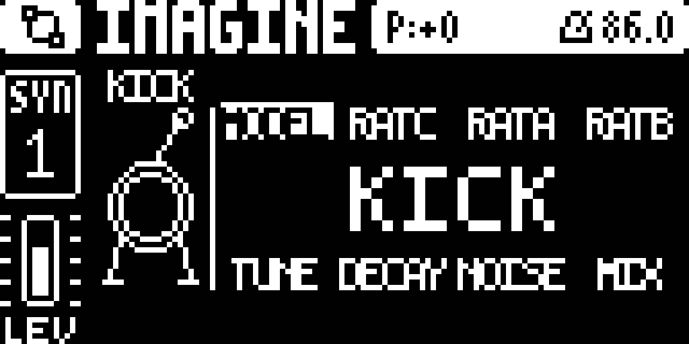

# DRUM+

DRUM+ is a one-shot percussion machine for the **Digitone mk1 / Digitone Keys
on OS 1.44**. It uses the stock FM voice as the exciter and builds a drum hit
around it: a pitch-dropping thump, noise/click, a ring modulator,
sample-rate/bit-depth redux and a deep wavefolder. The result enters the
track's own voice, so the filter, mixer, effects and AMP envelope shape it as
they shape FM.

This repository distributes the compiled `.elemod` release package only. It
contains no firmware, no `.syx` images and no source code.

## Download

- **DRUM+ 1.0**: `releases/DRUM+-1.0.elemod`
- SHA-256: see `releases/SHA256SUMS.txt`

## Install

DRUM+ is an elekloader machine mod, not a standalone OS. You need:

- the stock Digitone OS 1.44 `.syx`;
- [elekloader](https://github.com/irpina/elekloader);
- the **core-dn1 4.0** and **machines companion 0.2** elemods (obtained
  separately).

Build a custom OS containing core-dn1 4.0, machines 0.2 and
`DRUM+-1.0.elemod`, then send it to the unit with Elektron Transfer. Keep the
image to your own unit: it contains Elektron's firmware.

Recovery: hold **FUNC** while powering on, press **TRIG 4** (OS UPGRADE) and
send the stock OS `.syx`. The bootloader is never touched.

## Get started

Pick a model on **SYN1 A**, hit a trig and shape from there. A fresh DRUM+
starts on KICK with the model's own balance. All knobs keep their stock FM
slots, so p-locks, the two LFOs, MIDI CC and presets reach the machine
unchanged.

**SYN1 - the FM exciter**

- A **MODEL** - KICK..ZAP; also selects the FM algorithm.
- B **RATC** - FM ratio C offset.
- C **RATA** - FM ratio A offset.
- D **RATB** - FM ratio B offset.
- E **TUNE** - +/-24 semitones around the note, for the thump and ring.
- F **DECAY** - length of the one-shot hit.
- G **NOISE** - noise/click into the exciter; also FM feedback.
- H **MIX** - FM operator mix, left as FM's own.

**SYN2 - the drum shaper**

- A **BODY** - FM block and thump level.
- B **REDUX** - sample-rate reduction; higher is coarser, 0 is off.
- C **BITS** - bit depth; 127 is clean, lower values crush.
- D **DROP** - how far the thump starts above the note.
- E **RING** - ring-mod depth.
- F **CLICK** - attack transient level.
- G **FOLD** - wavefolder depth; higher folds harder.
- H **FREQ** - ring oscillator rate, 20 Hz to 12 kHz.

For the level controls (BODY, NOISE, CLICK, DROP, REDUX, RING, FOLD) 0 removes
the component, 64 leaves the model's value and 127 roughly doubles it. BITS is
a bit depth, FREQ sets the ring rate, and DECAY scales the model's decay. The
machine has no drive or tone filter of its own: the AMP page's stock drive and
the track's FILT page do that.

The eight models set the starting balance:

| model | character | model | character |
|---|---|---|---|
| KICK | long low body, pitch drop, little noise | TOM | tuned body, little ring |
| SNARE | noise/click, light ring and redux | CLAP | noise, three-burst flam, ring |
| HAT | noise, ring, redux, short decay | METAL | deep ring, folded edge |
| BONK | body-heavy, deep fold, short | ZAP | max pitch drop, redux, very short |

The output has a **2x (+6 dB) master gain** after the drum envelope. If the
track or AMP drive is too hot, lower the track level or AMP drive.

## Licence

DRUM+'s own code is GPL-2.0-or-later; see `LICENSE`. The elekloader SDK and the
core-dn1/machines companions carry their own licences. Unofficial, not
affiliated with Elektron. No OS image is distributed here.
